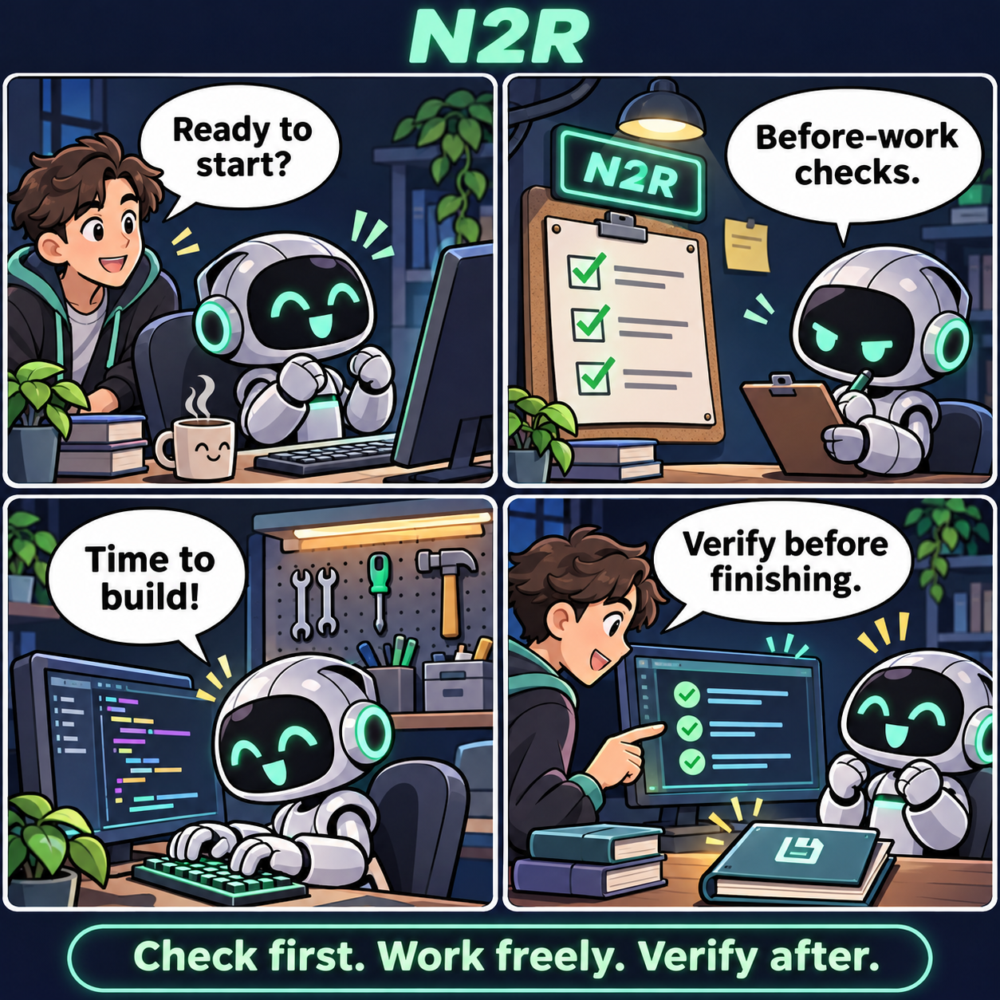
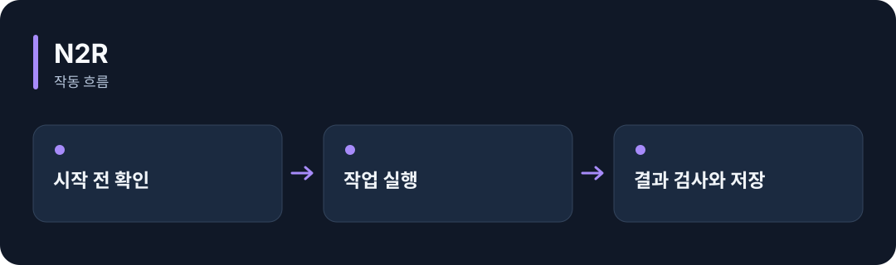

# N2R

**AI 작업의 시작 전 확인과 끝난 뒤 검사를 정해진 순서로 실행합니다.**

[](https://github.com/choihyunsus/n2-recipe/releases/tag/v1.0.1) [](https://github.com/choihyunsus/n2-recipe/blob/main/docs/reference.ko.md) [](https://github.com/choihyunsus/n2-recipe/blob/main/LICENSE)

[English](README.md)

<p align="center">
  
</p>

작업 준비를 확인하고 → 사전 검사를 거쳐 → 도구를 사용해 작업하고 → 결과를 검증하고 저장합니다.

기능을 이야기로 표현한 만화입니다. 실제 앱 화면은 아닙니다.

<details>
<summary>동작 흐름 펼쳐 보기</summary>



</details>

## 이런 때 사용하세요

코드 수정 전에 작업 폴더를 확인하고, 수정 뒤에는 테스트 결과를 확인하는 절차를 붙일 때 사용하세요.

무엇을 검사할지는 연결한 앱이 함수로 제공합니다. 작업 중에는 등록한 도구를 사용할 수 있고, 중단된 작업은 저장한 ID로 이어갑니다.

## 처음 실행하기

터미널에서 `node --version`을 실행해 Node.js 22 이상인지 확인하세요. 아래 명령은 새 연습 폴더를 만들고 GitHub 배포 파일을 설치합니다. 예제 파일과 DB도 이 폴더에 두면 경로를 따라가기 쉽습니다.

```sh
mkdir n2-recipe-demo
cd n2-recipe-demo
npm init -y
npm install https://github.com/choihyunsus/n2-recipe/releases/download/v1.0.1/n2-recipe-1.0.1.tgz
```

설치 중 SQLite 빌드 오류가 나오면 운영체제에 맞는 C/C++ 빌드 도구가 필요할 수 있습니다. 자세한 환경 조건은 [설치 참고](https://github.com/choihyunsus/n2-recipe/blob/main/docs/reference.ko.md)에 있습니다.

먼저 기본 작업 절차가 올바르게 준비됐는지 확인합니다.

```sh
npx --no-install n2-recipe validate
```

`"valid": true`와 단계 목록이 나오면 준비 확인이 끝났습니다. 실제 파일 작업까지 해보려면 상세 안내의 `examples/file-task.cjs` 연결 방법을 따라가세요. 앱에서 제공하는 시작 전 검사와 결과 검사 함수가 실제 완료 조건을 결정합니다.

실제 파일을 만드는 연습도 할 수 있습니다. 사용하는 터미널에 맞는 명령 한 묶음을 선택하세요.

**Windows PowerShell**

```powershell
mkdir workspace
$env:N2R_DEMO_DIR = (Resolve-Path ./workspace).Path
npx --no-install n2-recipe run --adapter ./node_modules/n2-recipe/examples/file-task.cjs --db ./demo.db --project demo --agent assistant --run-id first-run --task "Hello N2R"
```

**macOS / Linux**

```sh
mkdir workspace
export N2R_DEMO_DIR="$(pwd)/workspace"
npx --no-install n2-recipe run --adapter ./node_modules/n2-recipe/examples/file-task.cjs --db ./demo.db --project demo --agent assistant --run-id first-run --task "Hello N2R"
```

성공하면 `workspace/answer.txt`에 `Hello N2R`이 저장됩니다. 예제는 폴더 확인, 파일 쓰기, 내용 검사와 종료 기록을 실행합니다.

## Soul과 함께 쓰기

여러 N2 모듈을 연결할 때 같은 `mimir.db` 파일을 지정하세요. `project`는 작업 이름, `agent`는 계속 사용할 AI 이름입니다. 같은 작업의 기록을 이어 쓰려면 이 값들을 맞춥니다. 단독 사용도 같은 필드 구조를 사용합니다.

## 다음 단계와 상세 안내

[전체 사용 안내](https://github.com/choihyunsus/n2-recipe/blob/main/docs/reference.ko.md)에서 실제 앱 연결, API, 지원 범위, 복구 절차와 검증 범위를 확인할 수 있습니다. [배포 파일](https://github.com/choihyunsus/n2-recipe/releases/tag/v1.0.1)에는 설치할 버전과 변경 설명이 있습니다.

처음 나오는 용어는 이렇게 읽으면 됩니다. **MCP**는 AI 앱의 도구 연결 방식, **DB**는 저장 파일, **호스트**는 이 모듈을 연결해 실행하는 앱입니다.

사용·재배포 조건은 [라이선스](https://github.com/choihyunsus/n2-recipe/blob/main/LICENSE)를 확인하세요. 의존 모듈에는 별도 조건이 적용될 수 있으며, 상업 이용 조건은 상세 안내에 함께 설명되어 있습니다.
