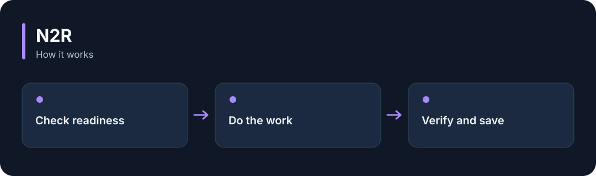

# N2R

**Run required checks before an AI task starts and after it finishes, in a defined order.**

[](https://github.com/choihyunsus/n2-recipe/releases/tag/v1.0.1) [](https://github.com/choihyunsus/n2-recipe/blob/main/docs/reference.md) [](https://github.com/choihyunsus/n2-recipe/blob/main/LICENSE)

[한국어](README.ko.md)



## When to use it

Use it to check the workspace before an edit and run the required tests after the edit.

The connected app supplies the functions that perform the checks. Registered tools remain available during work, and saved IDs let interrupted tasks resume.

## Try it

Run `node --version` in a terminal and check for Node.js 22 or later. These commands create a fresh practice folder and install the GitHub release. Keep the example file and database in this folder.

```sh
mkdir n2-recipe-demo
cd n2-recipe-demo
npm init -y
npm install https://github.com/choihyunsus/n2-recipe/releases/download/v1.0.1/n2-recipe-1.0.1.tgz
```

If installation reports a SQLite build error, you may need your platform’s C/C++ build tools. See the [installation reference](https://github.com/choihyunsus/n2-recipe/blob/main/docs/reference.md) for platform requirements.

First check that the bundled workflow definitions are valid.

```sh
npx --no-install n2-recipe validate
```

`"valid": true` and a list of phases confirm the definitions are ready. Follow the `examples/file-task.cjs` setup in the reference to run real file work. Your app’s preparation and verification functions define the actual completion checks.

You can also try a real file task. Choose the command block for your terminal.

**Windows PowerShell**

```powershell
mkdir workspace
$env:N2R_DEMO_DIR = (Resolve-Path ./workspace).Path
npx --no-install n2-recipe run --adapter ./node_modules/n2-recipe/examples/file-task.cjs --db ./demo.db --project demo --agent assistant --run-id first-run --task "Hello N2R"
```

**macOS / Linux**

```sh
mkdir workspace
export N2R_DEMO_DIR="$(pwd)/workspace"
npx --no-install n2-recipe run --adapter ./node_modules/n2-recipe/examples/file-task.cjs --db ./demo.db --project demo --agent assistant --run-id first-run --task "Hello N2R"
```

On success, `workspace/answer.txt` contains `Hello N2R`. The example checks the folder, writes the file, verifies its content and records completion.

## Using it with Soul

Point connected N2 modules at the same `mimir.db` file. `project` names the work and `agent` names the AI identity you will keep using. Match those values to continue working with the same records. Standalone use follows the same field layout.

## Next steps and reference

The [full reference](https://github.com/choihyunsus/n2-recipe/blob/main/docs/reference.md) covers app integration, APIs, supported features, recovery and validation. The [release page](https://github.com/choihyunsus/n2-recipe/releases/tag/v1.0.1) contains the installable version and release notes.

A few terms used in the reference: **MCP** connects tools to an AI app, a **database** stores records, and the **host** is the app that connects and runs this module.

Review the [license](https://github.com/choihyunsus/n2-recipe/blob/main/LICENSE) for use and redistribution. Dependencies can have their own terms, including commercial-use conditions described in the reference.
